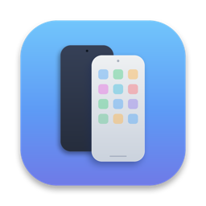

<p align="center">
  
</p>

# Android Mirror for macOS

A free, MIT-licensed macOS app for discovering and controlling Android devices through ADB and [scrcpy](https://github.com/Genymobile/scrcpy). Written in SwiftUI by Nipuna Lakruwan.

The native app manages devices, connection settings and controls. Live video opens in a **separate scrcpy window**; the phone bezel in the SwiftUI window shows session status.

## Requirements

- macOS 14 or later. Local build verified on Apple Silicon; Intel has not been verified in this review.
- Xcode Command Line Tools with a Swift toolchain supporting the package's `ApproachableConcurrency` feature. This checkout was built using Swift 6.4.2. The Swift tools 6.0 manifest declaration alone does not establish compatibility with every Swift 6.0 compiler.
- ADB and scrcpy installed separately. Local dependency verified: scrcpy 4.1.
- An Android phone with USB debugging enabled and this Mac authorized. Feature support depends on the Android version, device and scrcpy version; a complete Android-version compatibility matrix has not been tested.

## Build and run

```sh
brew install scrcpy android-platform-tools
git clone https://github.com/Nipuna-Lakruwan/AndroidMirror-macOS.git
cd AndroidMirror-macOS
swift build
swift run AndroidMirror
```

For a release app bundle:

```sh
./build_app.sh
open "/Applications/Android Mirror.app"
```

**The build script replaces `/Applications/Android Mirror.app`.** It builds for the current architecture and attempts ad-hoc signing. It does not produce a notarized installer or a universal binary, and currently ignores signing failures.

## Connect your phone

1. Enable Developer options and USB debugging on Android.
2. Connect a data-capable USB cable, unlock the phone and approve the USB debugging prompt.
3. Open Android Mirror, select an authorized device and choose **Start Mirroring**.
4. Use the separate scrcpy window to interact with Android.

For Wi-Fi or a phone hotspot, use the app's **Wireless Pairing** sheet after USB authorization. The current implementation enables legacy ADB TCP/IP on port 5555 and tries discovered or saved addresses. It does not implement Android's pairing-code workflow. USB-to-wireless handoff is implemented but has not been verified end to end in this review.

**Connection behavior:** background discovery can automatically remember an authorized USB device and enable wireless ADB. A default Wi-Fi gateway is treated as a possible hotspot address without proving it belongs to the remembered phone. Use a trusted network; disable wireless debugging on the phone when finished.

## Features and limits

| Capability | Current implementation |
| --- | --- |
| USB and wireless discovery | ADB device enumeration with model, Android version, battery and network details |
| Video and audio | External scrcpy process; configurable resolution cap, bitrate, FPS cap and Opus audio |
| Screen off | Passes scrcpy screen-power options; does not establish that Android is locked or physical input is disabled |
| Virtual display | Passes `--new-display`; requires compatible Android/scrcpy support; does not itself guarantee the physical screen is off |
| Touch-wake suppression | Writes two Android secure settings; currently resets both to `1` on exit rather than preserving their original values |
| Clipboard | scrcpy handles transfers in its own window; app copy/paste buttons send ADB keyevents and do not independently verify clipboard transfer |
| Screenshots | Saves a phone screenshot to the Mac Desktop when requested |
| Remembered devices | Stores device metadata and last-known addresses in local UserDefaults |

1440 and 120 FPS are selectable caps, not measured throughput guarantees. Audio support and actual performance depend on the phone and connection.

## Keyboard controls

These shortcuts belong to the **Android Mirror app window**:

| Shortcut | Action |
| --- | --- |
| Command + 1 | Home |
| Command + 2 | App switcher |
| Command + 3 | Notifications |
| Command + [ | Back |
| Command + L | Power/display toggle |
| Command + Shift + S | Screenshot to Desktop |
| Command + Shift + V | Send Android paste key; see clipboard limitation above |
| Command + Shift + C | Send Android copy key; transfer depends on scrcpy |

In the **scrcpy window**, use Command + C / Command + V for scrcpy copy and paste. Shortcuts are configured with `--shortcut-mod=lsuper,lalt`; see `scrcpy --help` for its full shortcut list.

## Architecture

```text
SwiftUI views
  ├─ AdbService (actor): discovery, device queries, Android commands
  ├─ AutoConnectionManager: polling, remembered devices, wireless attempts
  ├─ MirrorSessionManager: scrcpy arguments, process lifecycle and logs
  └─ ClipboardSyncManager: Mac pasteboard observation and ADB keyevents

ADB → authorized Android device
scrcpy → separate video/control window
```

Source is under `Sources/AndroidMirror/`; models, services and views are separated into subdirectories. `Package.swift` defines the executable and test target. `Info.plist`, `AppIcon.icns` and `build_app.sh` assemble the app bundle.

## Verification status

On 2 November 2026, the source built and `swift test` passed locally on Apple Silicon with Swift 6.4.2. The test target currently contains only an empty example, so that pass does **not** validate app behavior.

Read-only ADB checks found one authorized wireless Samsung SM-S918B reporting Android 17 / API 37. This verifies connectivity and metadata queries only. Video, audio, clipboard, physical touch isolation, settings restoration and USB handoff were not exercised in this review.

## Troubleshooting

- **ADB or scrcpy missing:** install the dependencies above. The app searches Homebrew and common Android SDK locations.
- **Unauthorized:** unlock the phone and approve its USB debugging prompt.
- **No wireless connection:** confirm the Mac and phone share a reachable network and the phone is listening on the configured port. Reconnect by USB if needed.
- **Blank or failed mirroring:** inspect the app's scrcpy log; try turning off virtual display or audio in Preferences.
- **Touch-wake preferences changed:** the current restoration implementation does not preserve original values. Recheck the phone's gesture settings after a session.

See [CONTRIBUTING.md](CONTRIBUTING.md) for development and [docs/REVIEW.md](docs/REVIEW.md) for outstanding engineering work.

## Project origin

This repository starts from the Android Mirror source by Nipuna Lakruwan in [AndroidMirror](https://github.com/Nipuna-Lakruwan/AndroidMirror), snapshot `f936ca1`. It includes the reviewed setup and contributor documentation. Personal phone screenshots are omitted.

## License and dependencies

Android Mirror is released under the [MIT License](LICENSE), copyright © 2026 Nipuna Lakruwan. ADB and scrcpy are external dependencies with their own licenses. The app is independent of Apple, Google, Samsung and VideoLAN.
